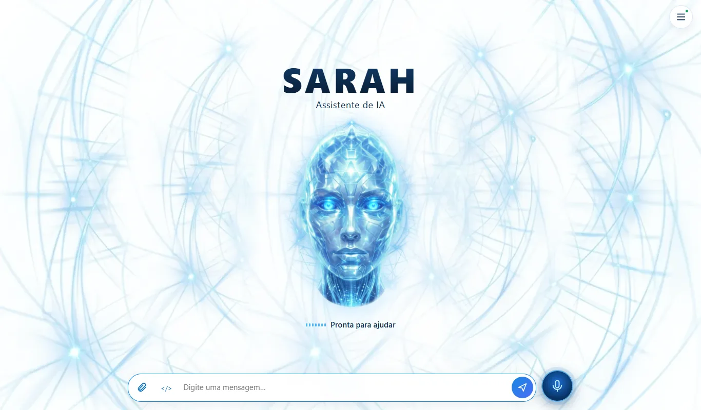
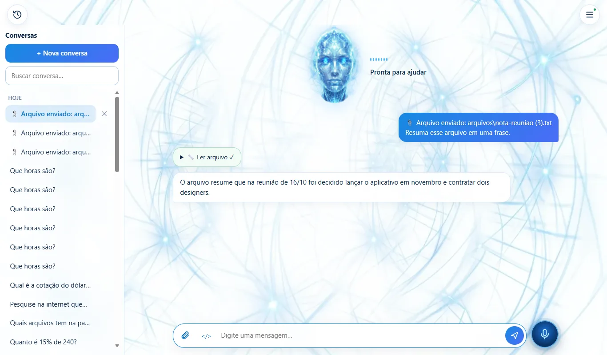
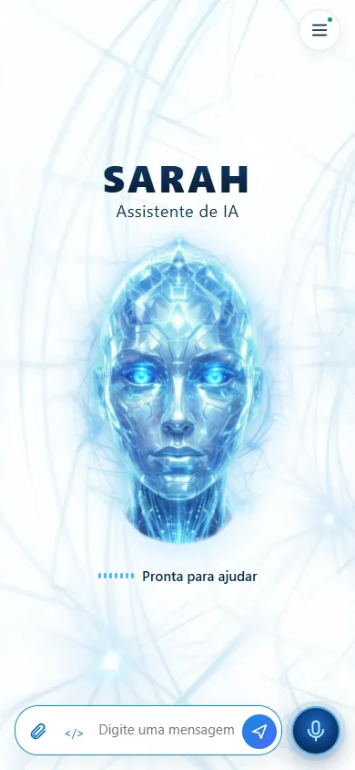
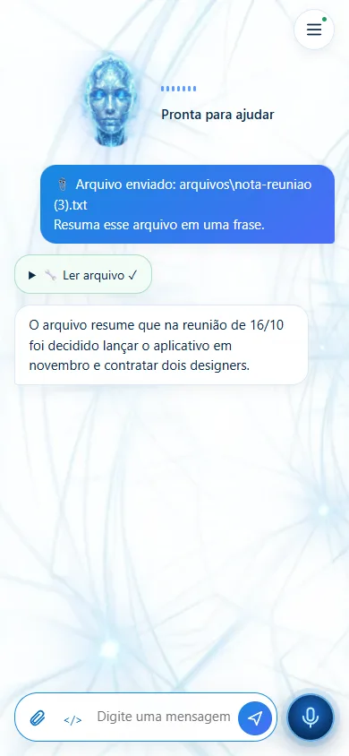
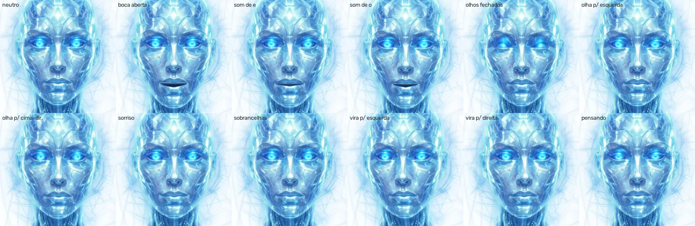
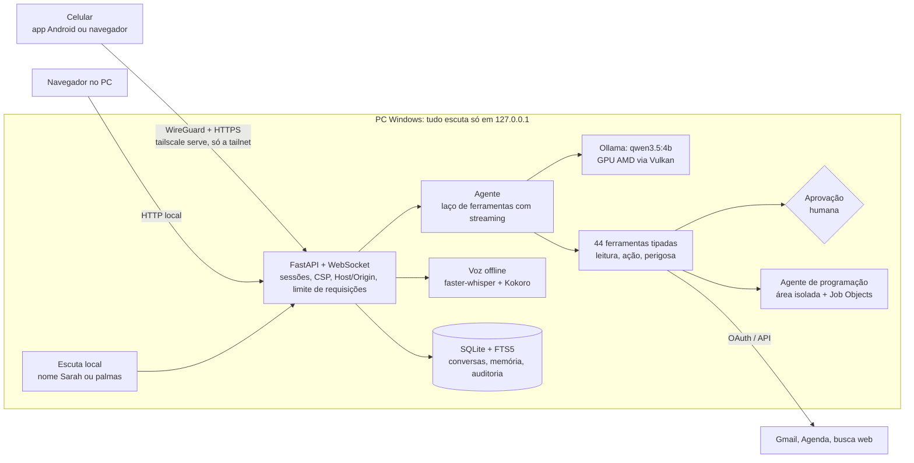

<div align="center">

# Sarah: assistente pessoal de IA 100% local

**Assistente de voz e texto em português que roda inteira no PC, com o modelo de linguagem na GPU. Ela controla o computador com confirmação humana, programa numa área isolada e atende pelo celular, sem API paga e sem mandar dados para a nuvem.**

[](https://www.python.org/)
[](https://fastapi.tiangolo.com/)
[](https://ollama.com/)
[](https://flutter.dev/)
[](https://www.khronos.org/webgl/)
[](docs/TESTING.md)
[](pyproject.toml)



</div>

## Em 30 segundos

- **O que é:** uma assistente pessoal completa (chat, voz, visão, ferramentas do sistema, e-mail, agenda e programação) que uso no dia a dia, rodando num PC comum com uma GPU AMD de 8 GB.
- **Problema resolvido:** ter um assistente útil de verdade **sem custo mensal e sem entregar conversas, arquivos e e-mails a terceiros**, mas com o mesmo cuidado de segurança de um produto exposto à rede.
- **O que o projeto demonstra:** arquitetura de agentes com LLM e ferramentas, segurança aplicada (modelo de ameaça documentado e testado), otimização guiada por medição, front-end sem framework (WebGL 2), app mobile em Flutter, testes automatizados e documentação técnica.

## Destaques

| | |
|---|---|
| 🧠 **LLM local na GPU AMD** | qwen3.5:4b via Ollama numa RX 6600 usando **Vulkan** (o ROCm não suporta essa GPU no Windows). ~3,7 GB de VRAM com contexto de 16K; primeiro token em **~0,7 s** depois da primeira mensagem. |
| 🛠️ **Agente com 44 ferramentas tipadas** | Arquivos, apps, navegador, diagnósticos, e-mail, agenda, busca na web, câmera, localização e programação, em **3 níveis de risco** (18 de leitura, 14 de ação e 12 perigosas). As perigosas só rodam depois de **aprovação na tela**, com o diff ou o comando exato. |
| 🗣️ **Voz offline** | Whisper (fala → texto) e Kokoro (texto → fala) na CPU, com resposta falada frase a frase enquanto o modelo ainda escreve. Ativação dizendo **"Sarah"**, inclusive sem nenhuma página aberta. |
| 👁️ **Visão sem custo extra** | O mesmo modelo analisa imagens enviadas e, a pedido, uma foto da câmera (6–10 s por imagem, sem segundo modelo na VRAM). |
| 👩‍💻 **Agente de programação** | Copia o projeto para uma área isolada, corrige, roda testes e lint por lista fixa de comandos, mostra o diff e integra com backup e reversão. Nunca faz commit nem push. |
| 🎭 **Rosto animado em WebGL 2** | Malha deformável (~15 mil pontos, no estilo dos avatares 2D) guiada pelo volume e pelo timbre da fala: boca, piscadas, olhar, sobrancelhas e giro em falso 3D a **~175 fps**. |
| 📱 **Acesso pelo celular** | Pela tailnet do Tailscale (WireGuard + HTTPS, **nenhuma porta aberta**) e por um app Android em Flutter. |
| ✅ **Qualidade** | **260 testes** automatizados (pytest), lint com ruff e testes de ponta a ponta com o modelo real, todos registrados em [TESTING.md](docs/TESTING.md). |

## Demonstração

| Conversa com ferramentas (PC) | Celular |
|---|---|
|  |   |

**Expressões do rosto** (poses fixadas pelo teste visual automatizado):



## Arquitetura



**Fluxo de uma mensagem:**
1. O WebSocket valida a sessão a cada mensagem.
2. O agente monta o contexto com as memórias relevantes (busca BM25 no FTS5) e as **ferramentas do assunto da conversa**.
3. O modelo responde em streaming e pode pedir ferramentas.
4. O servidor valida os argumentos, aplica as permissões e, se a ação for perigosa, pausa e pede aprovação na tela. Tudo vai para a auditoria.

O acoplamento com o modelo fica num único módulo ([`llm.py`](jarvis/llm.py)), então trocar o Ollama por outro servidor compatível não mexe no resto.

## Decisões de engenharia

| Decisão | Alternativa descartada | Motivo e resultado medido |
|---|---|---|
| Mostrar ao modelo só as ferramentas do assunto da conversa | Enviar as 44 sempre | Com todas, a 1ª mensagem levava **17 s** (~4 mil tokens de instruções). Por assunto: **4–7 s**. |
| Prompt de sistema estável (sem a hora) | Hora atual no prompt | O qwen3.5 é híbrido: o Ollama só reaproveita o cache quando o prompt novo estende o anterior. O primeiro token caiu de **~4 s para ~0,7 s**; a hora vem de uma ferramenta. |
| Laço de agente próprio (~50 linhas) | LangChain e similares | Auditável, sem dependências pesadas e com controle total do ponto de aprovação. |
| Isolamento com área copiada + Job Objects do Windows | Docker | O Docker Desktop custaria ~2 GB dos 16 GB de RAM. Limita memória e processos e encerra a árvore inteira. Sem isolamento de rede, **toda execução pede confirmação**. |
| Rosto por malha deformável em WebGL 2 | Rostos neurais falantes (MuseTalk, LivePortrait) | Esses só rodam em tempo real em GPUs NVIDIA. A malha roda a ~175 fps em qualquer navegador. |
| Visão com o mesmo LLM, imagens ≤1024 px e só as 2 mais recentes | Segundo modelo de visão (7B) | Não disputa VRAM; a precisão é suficiente para ler prints; liberou 6 GB de disco. |
| Acesso remoto por `tailscale serve` | Abrir porta no roteador, hospedar na nuvem | Grátis, sem porta exposta, HTTPS válido. Nuvem grátis seria só CPU (várias vezes mais lenta) e tiraria os dados do PC. |
| Memória por busca FTS5 (BM25) | Embeddings vetoriais | Zero dependências e resultados bons para o volume de um usuário. Embeddings ficam como evolução se a busca por palavras não bastar. |
| Front-end em JS puro, sem build | React ou Vue | Carrega rápido no celular, CSP `'self'` sem scripts inline e nada para compilar. |

Detalhes, medições do hardware e riscos: [ARCHITECTURE.md](docs/ARCHITECTURE.md).

## Segurança

Modelo de ameaça completo, com o teste que cobre cada item: [SECURITY.md](docs/SECURITY.md). Os pontos principais:

- **Nada exposto:** o servidor escuta só em `127.0.0.1`. O celular entra pela tailnet (sem Funnel); quem não está na conta Tailscale não alcança o endereço, e a senha continua obrigatória.
- **Autenticação:** senha com hash **scrypt**, token de sessão de 256 bits (o banco guarda só o SHA-256), cookie `HttpOnly` + `Secure` + `SameSite=Strict`, sessões revogáveis e limite de tentativas.
- **Web:** checagem de `Host` e `Origin` contra CSRF e DNS rebinding, CSP `default-src 'self'`, `X-Frame-Options: DENY` e HTML escapado antes de renderizar o Markdown do modelo.
- **Ferramentas:** não existe execução de comando livre. Os argumentos são validados, as pastas e apps são autorizados explicitamente e os caminhos passam por `resolve()`, então `..`, links e junções não escapam. Há três modos (simulação, normal com aprovação, somente leitura), e o modelo não consegue desligá-los.
- **Injeção de prompt:** conteúdo de arquivos, e-mails e páginas é marcado como dado não confiável. Mesmo que o modelo seja enganado, a ação perigosa ainda depende do clique humano.
- **SSRF:** a leitura de páginas bloqueia endereços internos, loopback, link-local, CGNAT e metadados de nuvem, e **conecta no IP já conferido** (com SNI), o que fecha a brecha de DNS rebinding entre a checagem e a conexão.
- **Segredos:** o token do Google e os dados faciais são cifrados com **DPAPI** do Windows. Nada vai para os logs, para o Git ou para o contexto do modelo.
- **Sessões remotas:** por padrão, só ferramentas de leitura; não ligam o microfone do PC nem mudam permissões.

## Qualidade e testes

```powershell
.venv\Scripts\python.exe -m pytest -q        # 260 testes
.venv\Scripts\python.exe -m ruff check .     # lint (regras em pyproject.toml)
```

- **Integração contínua:** workflow do GitHub Actions em [`ci.yml`](.github/workflows/ci.yml) roda o lint e todos os testes num Windows limpo, sem GPU e sem o modelo, com as actions fixadas por commit.
- **Unidade e integração:** autenticação, sessões, CSRF, rate limit, permissões e caminhos de cada ferramenta, agente com o modelo simulado, voz, escuta, visão, Google com a API simulada, SSRF, armazenamento e modo mãos livres.
- **Ponta a ponta com o modelo real:** escolha da ferramenta certa (10/10 em pedidos diretos), correção de projetos com bug pelo agente de programação, latência medida e navegador headless no PC e no celular. Cada execução está registrada em [TESTING.md](docs/TESTING.md), incluindo os bugs que os testes pegaram.
- **Testes visuais:** o rosto expõe um `hold()` para fixar poses e fotografá-las de forma determinística.

## Stack

| Camada | Tecnologias |
|---|---|
| Back-end | Python 3.11, FastAPI, Uvicorn, WebSocket, SQLite (FTS5), httpx |
| IA | Ollama (qwen3.5:4b, Vulkan), faster-whisper (CTranslate2 int8), kokoro-onnx, OpenCV (YuNet + SFace, opcional) |
| Front-end | HTML, CSS e JavaScript puros, WebGL 2, Web Audio, MediaDevices |
| Mobile | Flutter (WebView), permission_handler, file_picker |
| Infra | Tailscale (WireGuard, `serve`), Windows Job Objects, DPAPI |
| Integrações | Gmail e Google Agenda (OAuth 2.0), Tavily (busca), Wikipédia |
| Qualidade | pytest, ruff, GitHub Actions, Edge headless via CDP, emulador Android |

## Estrutura do repositório

```
.
├── jarvis/          # back-end (o pacote mantém o nome original do projeto)
│   ├── main.py      # rotas HTTP, WebSocket do chat, modo mãos livres
│   ├── agent.py     # prompt, memória, laço de ferramentas
│   ├── llm.py       # cliente do Ollama (único acoplamento ao modelo)
│   ├── tools.py     # registro de ferramentas, permissões e modos
│   ├── coding.py    # agente de programação em área isolada
│   ├── auth.py      # senha scrypt, sessões, Host/Origin
│   ├── voice.py · listener.py · vision.py · camera.py · face.py
│   ├── web.py       # busca e leitura de páginas com proteção SSRF
│   └── google_api.py · db.py · storage.py · secure.py · ...
├── web/             # interface sem build (app.js, avatar.js em WebGL 2, CSS)
├── android_app/     # app Flutter
├── tests/           # 260 testes pytest
├── site/            # páginas públicas exigidas pelo OAuth (privacidade e termos)
└── docs/            # manual, arquitetura, segurança, testes, instalação
```

## Como rodar

Requisitos: Windows 10/11, Python 3.11 e [Ollama](https://ollama.com). Funciona melhor com uma GPU de 8 GB, mas também roda na CPU, mais devagar.

```powershell
ollama pull qwen3.5:4b
git clone https://github.com/KennnedyRamos/sarah-assistente.git
cd sarah-assistente
iniciar.bat   # cria a .venv, instala as dependências, pede uma senha e abre http://127.0.0.1:8765
```

Passo a passo, voz, acesso pelo celular e app Android: [INSTALL_WINDOWS.md](docs/INSTALL_WINDOWS.md) e [MANUAL.md](docs/MANUAL.md).

## Limitações conhecidas e próximos passos

- **Só Windows:** Job Objects, DPAPI e a Lixeira são APIs do Windows.
- **Modelo de 4B:** ótimo custo-benefício, mas erra mais que modelos grandes em raciocínio longo e em código com muitos arquivos. A segurança não depende dele acertar.
- **Isolamento sem bloqueio de rede:** compensado pela confirmação obrigatória. Próximo passo: contêiner com `--network none` como opção.
- **Próximos passos:** ativação por voz no celular (serviço nativo em primeiro plano); busca semântica na memória.

## Documentação

[Manual de uso](docs/MANUAL.md) · [Arquitetura](docs/ARCHITECTURE.md) · [Segurança](docs/SECURITY.md) · [Testes](docs/TESTING.md) · [Instalação](docs/INSTALL_WINDOWS.md) · [Acesso remoto](docs/REMOTE_ACCESS.md) · [Integrações](docs/INTEGRATIONS.md) · [Solução de problemas](docs/TROUBLESHOOTING.md)

## Autor

**Kennedy Ramos**, desenvolvedor Full Stack (Python, Flutter e React)

[](https://www.linkedin.com/in/kennedy-silva-ramos-566b00150/)
[](https://kennnedyramos.github.io/)
[](https://kennedyramos-dev.vercel.app)

Gostou do projeto? Vamos conectar no LinkedIn. Estou aberto a oportunidades como desenvolvedor.

---

### In English

**Sarah** is a fully local personal AI assistant for Windows. A 4B LLM runs on an AMD GPU via Vulkan, and the assistant offers offline speech (Whisper and Kokoro), image understanding, a WebGL 2 animated face and a tool-calling agent with 44 typed tools in three risk levels. Dangerous actions require human approval with the exact diff or command. It also has an isolated coding agent, Gmail and Calendar over OAuth, phone access through Tailscale with no open ports, and a Flutter Android app. The project includes a documented threat model, measurement-driven optimizations (first message 17 s → 4–7 s, first token ~4 s → 0.7 s) and 260 automated tests.
